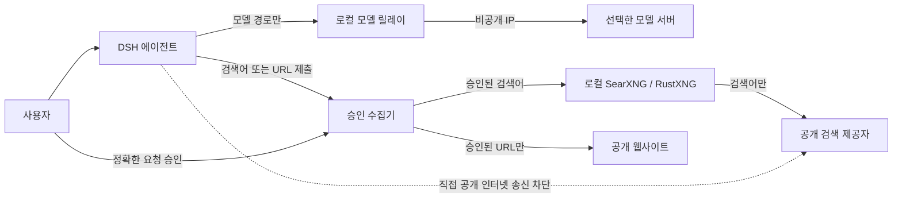

# 로컬 모델과 통제된 웹 접근

이 배포는 macOS 또는 Linux에서 DeepSeek Harness를 Docker 컨테이너로 실행합니다. DSH 프로세스는 선택한 비공개 모델 서버에만 모델 요청을 보내며, 공개 인터넷으로 직접 나가는 경로가 없습니다. 웹 검색과 페이지 가져오기는 별도 수집기가 사용자의 승인을 받은 뒤 처리합니다.

## 아키텍처와 기술 스택

배포 구성은 호스트 실행기, DSH 에이전트, 승인된 공개 데이터 수집기, 로컬 검색 엔진으로 나뉩니다. 각 구성 요소의 네트워크 권한은 [데이터 흐름과 네트워크](#데이터-흐름과-네트워크)에서 설명합니다.

| 구성 요소 | 스택 | 역할 |
| --- | --- | --- |
| 호스트 실행기 | Python 3 표준 라이브러리와 Docker CLI | 로컬 경로와 비공개 모델 endpoint를 확인하고, 모델 릴레이와 실행별 네트워크를 만들며, 컨테이너를 실행하고 관리 리소스를 정리합니다. |
| DSH 이미지 | Debian Bookworm 기반 Node.js 24, pnpm 11.28.5, TypeScript/ESM DSH 워크스페이스 | 에이전트 런타임을 빌드하고 Web 또는 headless Cordis 프로필을 불러옵니다. |
| 네트워크 제한 | Linux `iptables`, `ip6tables`, `setpriv` | DSH 코드를 불러오기 전에 기본 거부 규칙을 설치하고 Docker DNS를 차단한 뒤 에이전트 프로세스의 Linux capability를 제거합니다. |
| 승인 수집기 | 별도 컨테이너, Node.js ESM, Cordis `public-web` 프로필, `dsh-web-fetch-http` | 제한된 검색어나 가져오기 요청을 로컬 승인 전까지 대기시킵니다. 작업공간이나 Session 디렉터리는 마운트하지 않습니다. |
| 로컬 검색 | 컨테이너로 실행하는 [SearXNG](https://github.com/searxng/searxng)(Python)와 [RustXNG](https://github.com/sahenjp/RustXNG)(Rust) | 엔진이 없으면 고정한 소스 커밋을 빌드하고, 있으면 검토한 이미지 digest와 일치하는 컨테이너만 재사용합니다. 두 엔진은 사설 Docker 네트워크에서 승인된 검색어를 받습니다. |

호스트 실행기는 Python으로 동작합니다. 에이전트와 수집기는 동일한 Node.js 이미지에서 별도 컨테이너로 실행합니다. 프로젝트 작업공간과 영속 상태는 에이전트 컨테이너에만 마운트합니다. 선택 가능한 Hermes ACP 프로세스는 별도로 관리합니다.

## 빌드와 실행

저장소 루트에서 DSH 이미지를 빌드합니다. 빌드 시 `homelab-dsh-plugins` 저장소의 고정 커밋을 가져와 플러그인 패키지를 준비합니다. 검색 서비스를 처음 자동 실행할 때도 고정한 SearXNG와 RustXNG 소스를 가져와 빌드할 수 있습니다. 실행기는 DSH 이미지나 플러그인을 실행 중에 내려받지 않습니다.

```sh
docker build --build-arg DSH_CLIENT_COMMIT_HASH=$(git rev-parse HEAD) -f deploy/offline/Dockerfile -t dsh-offline:local .
python3 deploy/offline/run.py --workspace /absolute/project --state /absolute/private-dsh-state --model MODEL_ID --base-url http://127.0.0.1:18080/v1
```

호스트에는 Docker와 Python 3이 필요합니다. root가 아닌 사용자로 실행하세요. 작업공간은 호스트 홈 디렉터리나 컨테이너 시스템 경로와 겹치면 안 됩니다. 상태 디렉터리는 작업공간과 분리하고 다른 사용자가 읽지 못하도록 보관합니다. 작업공간과 상태 디렉터리에 기존 Unix 소켓이 있으면 실행기는 거부합니다. UI와 승인 페이지는 호스트 루프백 주소에만 게시됩니다.

모델 서버는 `/v1` 경로를 제공하는 비공개 IPv4 HTTP 서버여야 합니다. 릴레이는 모델 경로만 전달하고 자격 증명과 쿠키를 제거하며 요청 본문을 로그에 남기지 않고 리다이렉트를 거부합니다. 로컬 프록시가 외부 모델 서비스로 요청을 전달하면 모델 데이터는 해당 서비스로 전송되므로 요청을 로컬에 보관하는 서버를 사용하세요.

UI는 `http://127.0.0.1:3081`에서 열립니다. 실행기는 제어 터미널에 승인 URL을 표시합니다. 터미널이 없는 작업은 작업공간과 상태 디렉터리 밖에 `--approval-file /absolute/private-file`을 지정할 수 있습니다. 파일은 권한 0600으로 만들고 실행이 끝나면 지웁니다.

`--profile headless`는 UI를 끕니다. `--port`, `--collector-port`, `--context-window`, `--max-tokens`로 로컬 포트와 모델 한도를 설정할 수 있습니다. `--model-patch`는 작업공간 안의 신뢰하는 Cordis 오버레이를 받습니다. 플러그인이나 브라우저 설정을 바꿀 수 있지만 컨테이너 방화벽 정책은 바뀌지 않습니다.

## 플러그인 선택

선택 가능한 플러그인은 [homelab-dsh-plugins](https://github.com/recrack/homelab-dsh-plugins)에 있습니다. 새 상태 디렉터리에는 선택 플러그인이 자동 설치되지 않습니다. `--plugin <ID>`를 반복해 고른 플러그인을 Web 프로필에 추가합니다. 선택은 상태 디렉터리에 유지되어 이후 실행에도 활성 상태로 남습니다.

```sh
python3 deploy/offline/run.py --workspace /absolute/project --state /absolute/private-dsh-state --model MODEL_ID --base-url http://127.0.0.1:18080/v1 --plugin dsh-context --plugin dsh-claude-artifacts --plugin dsh-claude-design --plugin dsh-crew
```

사용 가능한 ID는 `dsh-browser`, `dsh-context`, `dsh-claude-artifacts`, `dsh-claude-design`, `dsh-crew`입니다. `dsh-context`의 고정본은 자동 카탈로그, 잔액, 추천 요청을 차단합니다. `dsh-claude-artifacts`와 `dsh-claude-design`은 로컬 Artifacts 페이지와 디자인 캔버스를 제공합니다. 디자인 플러그인의 upstream 프로젝트는 이전 Baoyu Design에서 이름이 바뀐 [Open Artifacts](https://github.com/JimLiu/open-artifacts)입니다. 이 이미지는 `homelab-dsh-plugins`에 고정된 버전을 사용하므로 카탈로그 고정을 갱신하고 이미지를 다시 빌드하기 전까지 upstream 변경은 반영되지 않습니다. DSH Crew는 실행 중인 DSH 허브를 사용하고 두 작업자 계층에 선택한 로컬 모델을 적용합니다. 비전과 이미지 생성 제공자는 꺼져 있습니다.

`dsh-browser`는 기본적으로 탐색 대상이 없습니다. 로컬 페이지를 허용하려면 매 실행마다 `dsh-browser`를 고르고 정확한 루프백 또는 사설 IPv4 origin을 지정합니다. origin을 여러 개 허용할 때는 옵션을 반복합니다.

```sh
python3 deploy/offline/run.py --workspace /absolute/project --state /absolute/private-dsh-state --model MODEL_ID --base-url http://127.0.0.1:18080/v1 --plugin dsh-browser --browser-origin http://127.0.0.1:4173
```

루프백 주소는 DSH 컨테이너를 가리킵니다. 브라우저 페이지가 하위 리소스를 요청할 수 있지만 방화벽은 지정한 주소와 포트만 허용합니다. 공개 웹사이트는 승인된 Web 수집기를 사용하세요.

일반 DSH 플러그인 개발은 [첫 플러그인 만들기](../../docs/user/develop/basic/index.md)와 [플러그인 패키징 및 설치](../../docs/user/develop/basic/publish.md)를 참고하세요. 검색 또는 가져오기 백엔드는 [dsh-web provider 추가](../../packages/web/web/README.md#adding-a-provider) 방식으로 확장할 수 있습니다. 이 배포는 Plugin Manager를 끄고, `deploy/offline/profile_plugins.py`를 통해 사용자가 고른 카탈로그 항목만 프로필에 설치합니다.

## 플러그인 아키텍처

Docker 빌드는 고정한 `homelab-dsh-plugins` 커밋을 가져와 `scripts/build.sh`를 실행합니다. DSH가 시작될 때 이 저장소를 clone하지 않습니다. 빌드된 Node.js 플러그인 패키지는 이미지에 연결됩니다. 실행할 때 `--plugin <ID>`는 `deploy/offline/profile_plugins.py`에 정의된 ID와 패키지 매핑에서 항목을 고릅니다. 실행기는 선택한 DSH bundle과 로컬 `file:` 의존성을 영속 Web 프로필에 기록하고, 패키지 디렉터리를 프로필의 `node_modules`에 연결합니다. 새 상태 디렉터리에서는 선택 플러그인을 활성화하지 않으며 이후 실행은 기존 선택을 유지합니다.

Web 프로필은 Cordis bundle과 플러그인 항목을 조합합니다. `dsh-context`, `dsh-claude-artifacts`, `dsh-claude-design`, `dsh-crew`는 Cordis patch를 추가하는 bundle입니다. `dsh-browser`는 선택했을 때 제공된 preset에 플러그인 항목으로 삽입합니다. 어떤 패키지를 골라도 보안 오버레이와 Linux 방화벽 정책은 유지됩니다. 플러그인을 골라도 공개 네트워크 권한은 생기지 않습니다. 브라우저가 접속할 origin은 매번 정확한 `--browser-origin` 항목으로 허용해야 합니다.

## 데이터 흐름과 네트워크



DSH 컨테이너의 IPv4와 IPv6 입력·출력 기본 정책은 DROP입니다. 허용되는 연결은 루프백, 선택한 모델 릴레이, 수집기 API, Web UI 게시 포트, 그리고 `--browser-origin`으로 지정한 사설 주소뿐입니다. Docker DNS도 차단합니다. 프로세스는 모든 capability를 버리고 `no-new-privileges`를 켠 뒤 시작합니다.

기본 Cordis 오버레이는 DeepSeek 모델 및 계정 provider, DeepSeek 검색 provider, 원격 세션 로그, OpenTelemetry 세션 텔레메트리, Plugin Manager, 제품 분석, 계정 UI를 끕니다. `api.deepseek.com`을 포함한 DeepSeek 도메인으로 직접 연결할 수 없습니다. 모델 릴레이는 요청 로그를 만들지 않습니다. 이 설정은 이 Docker 배포에 적용됩니다. 직접 지정한 모델 서버, 수동 검색 서비스, Hermes sidecar, 신뢰하는 `--model-patch`의 정책은 별도로 확인해야 합니다.

수집기는 검색에 `{query,maxResults}`, 가져오기에 `{url}`만 받습니다. 요청 전체를 호스트 전용 승인 페이지에 표시하고 사용자가 승인할 때까지 보류하며 자동 승인은 없습니다. 검색 제공자는 승인된 검색어와 검색 서비스의 공개 IP를 볼 수 있습니다. 공개 페이지에는 승인한 URL을 수집기가 요청하므로 사이트는 수집기의 공개 IP를 봅니다. 대화 기록, 파일, 자격 증명, 세션 로그는 검색어나 페이지 요청에 포함되지 않습니다.

검색은 기본적으로 자동 시작됩니다. 실행기는 검토한 이미지 digest와 일치하는 기존 컨테이너가 있으면 재사용하고, 서비스가 없으면 고정 커밋을 `~/.cache/dsh-offline/search-services`에 clone하여 빌드한 뒤 임시 내부 네트워크에서 실행합니다. 기존 서비스를 직접 관리한다면 두 엔진 URL과 네트워크 이름을 지정할 수 있습니다. `--search off`는 자동 실행을 끕니다.

관리형 SearXNG는 Google, Bing, DuckDuckGo, Brave만 사용합니다. 관리형 RustXNG는 DeepSeek 검색 엔진과 리서치 API를 끄고 직접 가져오기 방식을 사용합니다. 로컬 엔진은 승인된 검색어만 받고 DeepSeek API로 대체 전송하지 않습니다. `searxng:` 또는 `rustxng:` 접두어는 엔진 하나를 고르며, 다른 검색은 두 엔진 결과를 합칩니다. 검색 실패나 가져오기 실패 시 다른 provider로 자동 전환하지 않습니다.

수집기는 사용자 승인 후 공개 HTTP(S) URL을 가져올 수 있습니다. `deepseek.com`과 하위 도메인은 승인 또는 DNS 조회 전에 거부합니다. 검색 수집기는 대화 기록, 파일, 쿠키, 자격 증명을 로컬 검색 엔진에 전달하지 않습니다. 공개 검색어에는 비밀이나 사설 프로젝트 정보를 넣지 마세요.

## 로컬 검색 서비스

이미 검색 서비스를 관리한다면 두 endpoint URL과 네트워크 이름을 설정해 자동 검색 서비스 탐색 대신 사용합니다.

```sh
export DSH_SEARXNG_URL=http://172.30.0.3:8080
export DSH_RUSTXNG_URL=http://172.30.0.4:8080
export DSH_SEARCH_NETWORK=search-local-only
```

수동 엔진은 사설 IPv4 주소에서 동작하고 SearXNG 호환 `/search` JSON endpoint를 제공해야 합니다. `searxng:` 또는 `rustxng:`로 시작하는 요청은 해당 엔진만 사용하며, 나머지는 양쪽 결과를 합칩니다. 사용자가 승인한 정확한 검색어와 결과 수만 로컬 엔진으로 보냅니다.

## Hermes ACP

Hermes는 선택 가능한 ACP 하위 에이전트 backend이며 DSH 모델 provider가 아닙니다. DSH 조정자는 선택한 로컬 모델을 계속 사용하고, `Hermes + Qwen` preset은 Hermes sidecar에 코딩 작업을 위임합니다. 먼저 검증된 Hermes sidecar를 실행한 뒤 기존 Docker volume을 전달합니다.

```sh
python3 deploy/offline/run.py --workspace /absolute/project --state /absolute/private-dsh-state --model MODEL_ID --base-url http://127.0.0.1:18080/v1 --plugin dsh-crew --hermes-acp-volume dsh-hermes-acp-socket
```

볼륨은 `/run/hermes-acp`에 읽기 전용으로 마운트합니다. 소켓은 미리 만들어져 있어야 하며 호스트 사용자의 숫자 UID로 연결 가능해야 합니다. DSH Crew 조정자는 프로젝트 파일을 읽고 작업을 위임할 수 있지만 직접 파일을 쓰거나 명령을 실행하거나 도구를 설치할 수 없습니다. 별도 관리하는 sidecar 안의 네트워크 정책은 이 실행기가 강제할 수 없으므로 로컬 모델 endpoint를 사용하고 자체 텔레메트리와 공개 egress를 꺼야 합니다.

## 세션 데이터와 검사

실행기는 세션 호환성을 위해 작업공간을 호스트의 절대 경로로 컨테이너에 마운트합니다. 기존 Session과 첨부 파일은 상대 경로와 generation을 보존해 `STATE/home/.dsh`로 복사할 수 있습니다. 호스트 자격 증명이나 호스트 플러그인 설정은 복사하지 마세요.

```sh
python3 -m unittest discover -s deploy/offline -p 'test_*.py'
node --import tsx/esm --test deploy/offline/collector.test.mjs deploy/offline/local-search.test.mjs deploy/offline/web-provider.test.mjs deploy/offline/browser-policy.test.mjs deploy/offline/prepare-presets.test.mjs deploy/offline/preset-guard.test.mjs
```
